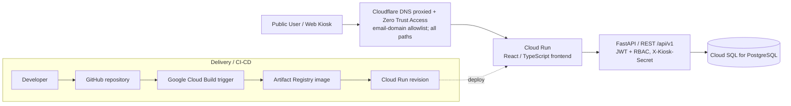

# Kiến trúc hạ tầng & triển khai CI/CD | Group 3 HRMS

> Ngày đối chiếu: 12/10/2026. Bản Markdown phục vụ review qua Pull Request, chuyển thể từ tài liệu Word do nhóm cung cấp và bổ sung thông tin Cloud Run YAML được cung cấp. **Không chứa mật khẩu, token hay connection string đầy đủ.**

## 1. Mục tiêu và phạm vi

Hai luồng độc lập: **runtime** (người dùng → Cloudflare → ứng dụng → DB) và **delivery** (developer → GitHub → Cloud Build → Artifact Registry → Cloud Run). GitHub không xử lý HTTP request của người dùng.

**Quy ước bằng chứng:** `[Repo]` mã nguồn/tài liệu; `[YAML]` Cloud Run Service YAML nhóm cung cấp; `[Nhóm]` nhóm xác nhận cấu hình Cloudflare; `[Chưa xác minh]` chưa có bằng chứng trực tiếp.

## 2. Sơ đồ kiến trúc

> Sơ đồ là **logic**. Từ YAML xác nhận một Cloud Run Service có container port 8080 và kết nối Cloud SQL; việc frontend/backend chạy riêng service hay chung container **chưa được kiểm chứng**.

## 3. Thành phần và trách nhiệm

| Thành phần | Chức năng | Bằng chứng |
| --- | --- | --- |
| Public user / Kiosk | Nhân viên, HR, quản lý, thiết bị quét QR | [Repo] |
| Cloudflare DNS | Hostname `hrms-group3.vuta.it.com`, DNS proxied | [Nhóm] |
| Cloudflare Zero Trust Access | Cho phép truy cập theo domain email được chỉ định, bao phủ tất cả path | [Nhóm] |
| Frontend | React + TypeScript + Vite, client giao tiếp API | [Repo] |
| Backend | FastAPI REST, JWT, RBAC ADMIN/HR/MANAGER/EMPLOYEE; kiosk dùng `X-Kiosk-Secret` | [Repo] |
| Database | Cloud SQL for PostgreSQL, kết nối qua Cloud SQL Unix socket | [YAML] |
| GitHub | Source, PR, lịch sử thay đổi | [Repo] |
| CI/CD | Google Cloud Build → Artifact Registry → Cloud Run | [YAML] |

## 4. Luồng truy cập người dùng

1. Người dùng mở `https://hrms-group3.vuta.it.com/`. Cloudflare DNS proxied đưa lưu lượng tới Cloudflare edge.
2. Cloudflare Access kiểm tra danh tính và domain email được phép trên tất cả path thuộc ứng dụng Access. Đây là bảo vệ **edge** và không thay thế JWT/RBAC của HRMS.
3. Web app tải giao diện; frontend gọi backend qua `/api/v1/*`, backend kiểm tra JWT, quyền nghiệp vụ rồi đọc/ghi Cloud SQL.
4. Kiosk gửi request chấm công với `X-Kiosk-Secret`; cần bảo đảm luồng đăng nhập của thiết bị trình duyệt tương thích với Access. Không nhầm lẫn xác thực Cloudflare với xác thực riêng của thiết bị.

**Cảnh báo bảo mật đã xác nhận:** Cloud Run YAML có `run.googleapis.com/ingress: all` và `run.googleapis.com/invoker-iam-disabled: "true"`. Do đó có thể truy cập origin Cloud Run trực tiếp, **bỏ qua Cloudflare Access**; cần kiểm soát ở origin và xác minh domain thay thế sau khi thay đổi.

## 5. Chi tiết Google Cloud đã xác minh

| Thuộc tính | Giá trị từ Cloud Run Service YAML |
| --- | --- |
| Project ID | `gen-lang-client-0909712835` |
| Cloud Run service | `hrproject-msa45hcm-group3` |
| Region | `us-west1` |
| Cloud SQL instance connection | `gen-lang-client-0909712835:us-west1:hrproject-group3-db` |
| DB driver/config | SQLAlchemy asyncpg; sync psycopg2; Unix socket `/cloudsql/...` |
| Artifact Registry | `us-west1-docker.pkg.dev/.../cloud-run-source-deploy/...` |
| Commit SHA (image label) | `16b0a39a51b35fb8c539822cf753fe28bd7a3adb` |
| Cloud Build trigger ID | `8b04b004-b4fe-4190-bfd0-d3d72135458c` |
| Cloud Build build ID | `469dc226-729d-4ed4-ab72-51ce1292c8c7` |
| Cloud Run revision | `hrproject-msa45hcm-group3-00021-45d`, 100% traffic at snapshot |
| Scaling | min 0, max 1 |
| Container settings | port 8080, concurrency 80, timeout 300s |
| Resources | 1 vCPU, 512 MiB memory |
| Runtime service account | Default Compute Engine service account (see Cloud Run YAML; review IAM) |
| Ingress / invoker | `all` / IAM invoker check disabled |

**Không kết luận** database sử dụng private IP chỉ vì ứng dụng kết nối qua Cloud SQL Unix socket.

## 6. Luồng CI/CD

1. Developer commit/push hoặc merge trên GitHub.
2. Cloud Build trigger được liên kết với deployment Cloud Run (bằng chứng qua label `gcb-trigger-id`).
3. Build tạo container image và lưu vào Artifact Registry.
4. Cloud Run triển khai revision mới từ image và định tuyến traffic.

Các bước kiểm thử `npm build`, `pytest`, lint, scan, branch trigger, approval gate, và chiến lược rollback **chưa thể khẳng định đã cấu hình** từ Cloud Run YAML. Cần đối chiếu trực tiếp Cloud Build Trigger, build logs và GitHub branch settings.

## 7. Bảo mật theo lớp và rủi ro

| Lớp | Kiểm soát | Trạng thái / rủi ro |
| --- | --- | --- |
| Cloudflare Edge | DNS proxied + Access policy theo email domain và toàn path | [Nhóm] |
| Origin Cloud Run | Chặn bypass qua direct `run.app` URL | **Chưa có**: ingress all + invoker IAM disabled |
| Backend | JWT/RBAC + Kiosk secret | [Repo]; cần test policy endpoint |
| Database | Cloud SQL, quyền DB riêng | [YAML]; private IP/backups chưa xác minh |
| Secrets | Secret Manager + rotation | **Cần khắc phục**: mật khẩu DB xuất hiện dạng plaintext trong environment YAML được chia sẻ |
| CI/CD IAM | Quyền triển khai tối thiểu, identity federation | [Chưa xác minh] |
| Observability | Logs/metrics/alerts, revision rollback | [Chưa xác minh] |

**Hành động khẩn cấp:** Đổi (rotate) credential PostgreSQL đã xuất hiện trong YAML được chia sẻ; cập nhật runtime an toàn và lưu vào Secret Manager. Không lưu credential vào GitHub hoặc tài liệu.

## 8. Hạng mục cần xác minh trước khi chốt As-Is

- Cloud Build trigger: source repo, branch/tag, substitutions, steps, test gates, service account và quyền deploy.
- Environment topology: dev / staging / prod, Artifact Registry image retention, manual approval.
- Cloud SQL: private/public IP, authorized networks, DB IAM, backup/PITR và lịch restore drill.
- Cloudflare Access: app hostnames, đường dẫn, session, IdP, email-domain group, xử lý kiosk.
- Cloud Run origin: biện pháp chống direct bypass, có/không Load Balancer và chính sách ingress phù hợp.
- Cloud Logging, Monitoring, alerting, healthcheck và cách rollback revisions.

## 9. Kết luận

Group 3 HRMS tách luồng người dùng qua Cloudflare và luồng triển khai từ GitHub/Cloud Build. Cloud Run vận hành ứng dụng, Cloud SQL lưu trữ dữ liệu. Hiện **kiểm soát Cloudflare không cưỡng chế trên origin** vì Cloud Run vẫn mở direct ingress; đây là ưu tiên cải thiện hàng đầu cùng với xử lý credential PostgreSQL.

### Nguồn đối chiếu

- Tài liệu nhóm: *Kiến trúc hạ tầng & triển khai CI/CD*, bản Word ngày 12/10/2026 (3 trang).
- Repository: `README.md`, `docs/ARCHITECTURE.md`, `docs/SETUP_GUIDE.md`.
- Cloud Run Service YAML do nhóm cung cấp ngày 12/10/2026. Đây **không** phải Cloud Build pipeline YAML.
